<div align="center">



<br/>

[](https://www.linkedin.com/in/arjun-balaji-s-288b9331b/)
[](mailto:sbalajiarjun@gmail.com)

<br/>

**[Who I am](#-who-i-am)** · **[Effort in numbers](#-effort-in-numbers)** · **[How I work](#-how-i-work)** · **[Projects](#-what-i-have-built)** · **[Stack](#-stack)** · **[Hackathons](#-hackathons--honours)** · **[Education](#-education)**

</div>

---

## 👋 Who I am

> I'm an **M.Sc. Software Systems (5-year integrated)** student at **Coimbatore Institute of Technology**.
> I build things end to end: a React or Angular front end, a Node/Express API, a database underneath, and, when the problem needs it, a machine-learning model that makes sense of the data.

I'm looking for an **entry-level Software Engineer, Full-Stack Developer or Data/ML role** where I can keep building and keep getting better.

```text
┌───────────────────────────────────────────────────────────┐
│  track 01 │ Full-Stack  → React · Angular · Node · SQL    │
│  track 02 │ Data & ML   → Pandas · Scikit-learn · EDA     │
│  off-duty │ NCC · Ball Badminton · Cricket                │
└───────────────────────────────────────────────────────────┘
```

---

## 📈 Effort in numbers

<div align="center">
  
</div>

---

## 🔧 How I work

| | What it looks like in practice |
|---|---|
| 🧱 **I finish the whole stack** | SkillProof runs from a React UI through an Express API with JWT auth down to PostgreSQL tables for profiles, skills, assessments, projects and certifications. |
| 🔍 **I sweat the details** | DROP has routing, authentication, CAPTCHA, form validation, Angular Signals and search/filtering, the unglamorous parts that make an app feel real. |
| 📊 **I let the data lead** | Every ML project starts with exploration, cleaning and visualisation before any model is trained, then correlation analysis and evaluation. |
| 🏁 **I compete to learn faster** | Hackathon deadlines force quick decisions and teamwork, and I reached the finals at Edutunter and the second round at Innovatex. |
| 🎖️ **I carry discipline over from NCC and sport** | NCC Lance Corporal rank, district-level badminton runner-up and a CIT Alumni Trophy cricket runner-up: leadership and teamwork under pressure. |

---

## 🚀 What I have built

### 🌐 Full-Stack

<div align="center">

| Project | Stack | What I did |
|---|---|---|
| **🏛️ [AETHER](https://github.com/Arjunbalaji123?tab=repositories)**<br/>Interactive Digital Museum of the Future | HTML · CSS · JavaScript | Built an interactive museum with exhibitions, timelines, favourites and archive browsing, with responsive layouts and dynamic JavaScript interactions. |
| **📦 [DROP](https://github.com/Arjunbalaji123?tab=repositories)**<br/>Peer-to-Peer Storage Marketplace | Angular · TypeScript · Bootstrap · Signals · Router | Built the marketplace with routing, authentication, CAPTCHA, form validation, Signals and search/filtering. |
| **✅ [SkillProof](https://github.com/Arjunbalaji123?tab=repositories)**<br/>Skill Verification & Portfolio Platform | React · Node.js · Express · PostgreSQL · JWT | Implemented authentication, project verification and certification tracking; modelled users, skills, assessments, projects and certifications in PostgreSQL. |

</div>

### 📊 Data & Machine Learning

<div align="center">

| Project | Stack | What I did |
|---|---|---|
| **⚡ [Campus Energy Anomaly Detection](https://github.com/Arjunbalaji123?tab=repositories)** | Python · Pandas · NumPy · Scikit-learn · Matplotlib | Analysed campus energy consumption to find usage patterns and detect anomalies with machine learning. |
| **🛡️ [Network Intrusion Detection](https://github.com/Arjunbalaji123?tab=repositories)** | Python · Pandas · Scikit-learn · Random Forest · Federated Learning | Built a privacy-preserving system that detects intrusions from distributed client data using federated model training. |
| **🎓 [Student Performance Analysis](https://github.com/Arjunbalaji123?tab=repositories)** | Python · Pandas · Matplotlib · Scikit-learn | Used EDA, visualisation, correlation analysis and ML to find the factors that influence academic performance. |

</div>

---

## 🛠️ Stack

<div align="center">

| | |
|---|---|
| **Languages** |       |
| **Frontend** |      |
| **Backend** |     |
| **Databases** |   |
| **Data & ML** |      |

</div>

---

## 🏅 Hackathons & honours

```text
2 hackathons ─┬─ Edutunter   →  Finalist
              └─ Innovatex   →  Selected for the Second Round

3 honours ────┬─ NCC "A" Certificate  →  Lance Corporal Rank (2nd)
              ├─ Ball Badminton       →  District-Level Runner-up
              └─ Cricket              →  Runner-up, CIT Alumni Trophy
```

---

## 🎓 Education

| Degree | Institution | Score |
|---|---|---|
| M.Sc. Software Systems (5-Year Integrated) | Coimbatore Institute of Technology | CGPA 7.93 |
| HSC (+2) | Vidhya Vikashni, Tiruppur | 86% |
| SSLC | Vidhya Vikashni, Tiruppur | 81% |

---

<div align="center">

### 📬 Let's build something

If you have an entry-level opening, a project or an idea, I'd like to hear about it.

[](https://www.linkedin.com/in/arjun-balaji-s-288b9331b/)
[](mailto:sbalajiarjun@gmail.com)


</div>

<!--
Optional: live GitHub stats once you have public activity (these rely on third-party
services, so they can break; that is why they are not on by default):


-->
